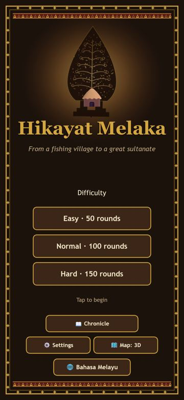
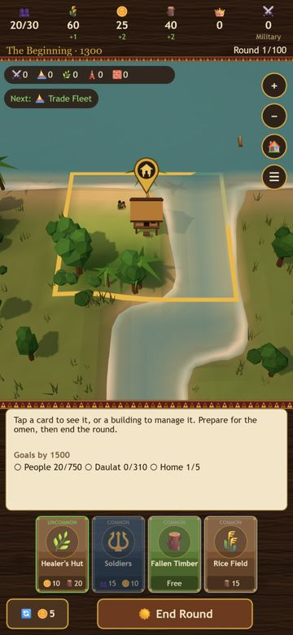
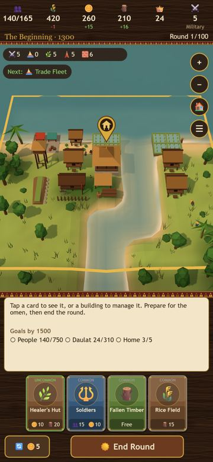
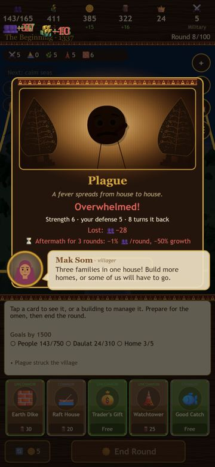
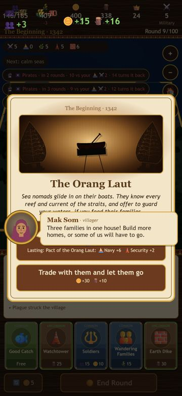

# Hikayat Melaka

**From a fishing village to a great sultanate, one card at a time.**

### ▶ [Play in your browser](https://tohawk89.github.io/hikayat-melaka-play/)

Free · no install · made for phones (portrait), works on desktop · English and Bahasa Melayu

---

*Hikayat* is Malay for a told tale. This one begins with a single hut by the water in **1300** and ends, if you rule well, with the **Istana of Melaka in 1500**. Each round you draw a hand of cards, build on a small 3D map, and get ready for whatever the omen says is coming: a flood, pirates, a trade fleet, or war.

This page is a short player's guide. This repository only holds the built game; it updates itself whenever a new version is published.

<table align="center">
  <tr>
    <td align="center"> the first hut</td>
    <td align="center"> a growing village</td>
    <td align="center"> the omen comes true</td>
    <td align="center"> history knocks</td>
  </tr>
</table>

## Contents

- [Quick start](#quick-start)
- [A round, step by step](#a-round-step-by-step)
- [Resources and powers](#resources-and-powers)
- [Cards](#cards)
- [Buildings](#buildings)
- [The village home](#the-village-home)
- [Disasters](#disasters)
- [Gifts and stories](#gifts-and-stories)
- [Eras](#eras)
- [The endgame](#the-endgame)
- [Difficulty and goals](#difficulty-and-goals)
- [Endings and score](#endings-and-score)
- [Tips](#tips)
- [Questions](#questions)

## Quick start

1. Open the [game](https://tohawk89.github.io/hikayat-melaka-play/) and pick **Easy**, **Normal** or **Hard**. Your first time, a short practice village shows you the basics; you can skip it.
2. Tap a card to read it, then **Play**. A building card asks for a tile: tap a glowing one.
3. Read the **omen** at the top of the map. It says what happens when the round ends.
4. Press **End Round**. Repeat until 1500.

On the map: drag to look around, pinch or **+ / −** to zoom, **🏠** to fly back to your home, **☰** for the menu (settings, how to play, save and quit). Tap any building to see what it does, move it, sell it or knock it down. The game saves as you play; **Continue** on the title screen picks up where you left off.

## A round, step by step

1. **Draw.** You get a fresh hand: 4 cards at first, more as your home grows (and with the Wise Elder or the Royal Seal), never more than 6.
2. **Play.** Spend resources on cards. Don't like your hand? **🔄 Reroll** it for gold (see [Cards](#cards)).
3. **End the round.** In order:
   - your buildings and cards **produce**;
   - great works under construction take a round of **building work** (if you can pay);
   - everyone **eats** (¼ rice per person) and the court takes its **daulat**;
   - any disaster **aftermath** takes its toll;
   - people **move in** if there is food and housing (8% a round), or **leave** if the village is overcrowded;
   - the **omen** comes true, at night, as a wayang shadow play.
4. **Dawn.** A new round, a new hand, a new omen.

## Resources and powers

| | Resource | Comes from | Goes to |
|---|---|---|---|
| 👥 | **Rakyat** (people) | growth, settlers, people cards, stories | soldiers and armies; lost to plague, war and hunger |
| 🌾 | **Padi** (rice) | rice fields, fish traps, kelongs, jetties, your home | ¼ per person per round, and soldiers |
| 🪙 | **Emas** (gold) | markets, ports, merchants, trade fleets | most cards, rerolls, upkeep |
| 🪵 | **Kayu** (wood) | woodcutters, your home, timber | buildings, home upgrades, great works |
| 👑 | **Daulat** (royal standing) | masjids, heroes, relics, disasters turned back, stories | home upgrades, decrees; the court costs 1 a round per 120 people |

The small number under each resource is what it gains or loses each round. Tap a resource to see exactly where that comes from.

**Powers** stand between you and disasters. They come from buildings, people and items in play:

| | Power | Defends against |
|---|---|---|
| ⚔️ | Military | war, the Portuguese (and helps against pirates and unrest) |
| ⛵ | Navy | pirates, the Portuguese (and helps in war) |
| 🌿 | Health | plague |
| 🗼 | Security | thieves, unrest |
| 🧱 | Flood defence | floods |

## Cards

There are **39 cards** to draw, plus relics that only stories can give. Rarer cards are stronger: Common, Uncommon, Rare, **Legendary** and **Unique**.

| Type | What it does | Examples |
|---|---|---|
| **Resource** | an instant gain | Bumper Harvest (+40 rice, free), Trader's Gift (+35 gold, free), Ming Porcelain |
| **Building** | goes on a tile and works every round | House, Rice Field, Market, Jetty, Watchtower |
| **People** | join the village; some stay in play | Wandering Families, Soldiers, Merchants, Army |
| **Item** | stays in play with a lasting effect | Monsoon Charts, Heirloom Keris, Royal Seal |

- **Heroes and legends** (unique and legendary cards: Parameswara, Tun Perak, Hang Tuah, the Treasure Ship…) are one of a kind: you can't draw or play one while it is already in play. Many bring their own stories while they stay.
- **Some cards need a building**: Soldiers and the Army need a Barracks, Merchants need a Market.
- **Limits on copies.** A few cards that stay in play are capped by your buildings, so growing them means building the map:

  | Card | Most in play at once |
  |---|---|
  | Soldiers | 3 per Barracks |
  | Army | 1 per Barracks |
  | Merchants | 2 per Market or Great Port |
  | Monsoon Charts | 1 per Jetty or Great Port |
  | Embassy | 2 |

  A card at its limit stops showing up in your hand until you build more of what it needs. The card says how many you have, e.g. "In play 2/3 · 3 per Barracks".
- **Reroll** (🔄, left of End Round): pay gold for a fresh hand, at most twice a round. It costs 5 gold in the first era, rising to 20 in the last, and **doubles each time you use it**. The price only drops back a step after a round in which you don't reroll, so rerolling every round gets expensive fast.

## Buildings

Buildings only go inside your plot (the gold border), which grows as you upgrade your home.

| | Building | Cost | Does | Notes |
|---|---|---|---|---|
| 🏡 | House | 20 🪵 | +15 housing | |
| 🌾 | Rice Field | 15 🪵 | +8 🌾 | plains only; ×1.5 next to a river; merges |
| 🪓 | Woodcutter | 10 🪙 5 🪵 | +6 🪵 | ×2 on jungle; merges |
| 🏪 | Market | 30 🪵 15 🪙 | +8 🪙 | merges |
| ⚓ | Jetty | 35 🪵 | +4 🌾 +4 🪙, ⛵ +3 | next to water |
| ⛵ | Great Port | 120 🪵 100 🪙 | +25 🪙, ⛵ +10 | next to water; from the Age of Trade |
| ⚔️ | Barracks | 40 🪵 20 🪙 | ⚔️ +5, −1 🪙 a round | lets you recruit Soldiers and the Army |
| 🗼 | Watchtower | 25 🪵 | 🗼 +5 | towers must stand 3 tiles apart |
| 🌿 | Healer's Hut | 20 🪵 10 🪙 | 🌿 +5 | |
| 🧱 | Earth Dike | 30 🪵 | 🧱 +6 | turns to face the water |
| 🕌 | Masjid | 120 🪵 80 🪙 | +2 👑, 🌿 +3 | from the Age of the Sultanate |
| 🎣 | Kelong | 30 🪵 | +6 🌾 +2 🪙 | on a sea tile |
| 🐟 | Fish Traps | 10 🪵 | +5 🌾 | on a river tile |
| 🛶 | Raft House | 20 🪵 | +12 housing | on a river tile |

**Merged plots:** rice fields, woodcutters and markets placed side by side with their own kind join into one bigger plot: **+25%** for two in a row, **+50%** for a 2 × 2 square. They are drawn as one big paddy, lumber yard or market square.

Moving a building costs a quarter of its price; selling one returns half.

## The village home

Tap your home to upgrade it. Each tier gives more land, more production and housing, and (from tier 2) one more card in your hand.

| Tier | Home | Plot | Upgrade cost | Needs |
|---|---|---|---|---|
| 1 | 🛖 Kampung Hut | 3 × 3 | | |
| 2 | 🏠 Headman's House | 5 × 5 | 60 🪵 30 🪙 | |
| 3 | 🏛️ Balai Hall | 7 × 7 | 150 🪵 120 🪙 5 👑 | Founding of Melaka |
| 4 | 🏯 Small Istana | 9 × 9 | 300 🪵 300 🪙 15 👑 | Age of the Sultanate |
| 5 | 🏰 Istana Melaka | 9 × 9 | 600 🪵 700 🪙 30 👑 | the Golden Age |

The home can never be destroyed.

## Disasters

Every round may bring an event. Small ones (thieves, unrest) are announced at the start of the round they strike. **Big ones (flood, plague, pirates, war) are foretold** 2–3 rounds ahead by your advisor, with a countdown in the omen bar, so you have time to prepare.

The omen shows the disaster's **strength**, your **defense** against it, and the defense that would **turn it back**:

> 🌊 Flood · in 2 rounds · 12 vs your 🧱10 · 18 turns it back

| Outcome | When | What happens |
|---|---|---|
| 🟢 **Turned back** | defense reaches the "turns it back" number | no losses, +1 👑 |
| 🟡 **Held, with losses** | defense at least the strength | you lose part of what it hits, plus 2 rounds of aftermath |
| 🔴 **Overwhelmed** | defense below the strength | heavier losses, 3 rounds of aftermath, and a building may fall |

The stronger your defense, the less you lose, but turning a disaster back completely takes much more: 1.25 × its strength early on, rising to **2 ×** by 1500. Losses are a share of what you hold, so they grow with your realm.

**Aftermath.** A disaster that isn't turned back keeps hurting for a few rounds, and you can see it on the map:

| Disaster | Takes | Each round of aftermath | On the map |
|---|---|---|---|
| 🌊 Flood | rice; can sweep away a building by the water | −50% rice income | the water stays up, a little lower each round |
| 🤒 Plague | people | half the usual growth, −1% people | a sickly mist over the houses |
| 🏴‍☠️ Pirates | gold and rice; can burn a building by the water | −50% gold income | smoke over the waterfront |
| 🐘 War | people and gold; can burn a building, kills soldiers | −30% rice income, −6% gold | fields and the village edge still burning |
| 🦹 Thieves | gold and some rice | | |
| ✊ Unrest | daulat and gold (more likely when your daulat is low) | | |

Hit by the same disaster again before it ends, the aftermath is extended, not doubled.

## Gifts and stories

- **Good events:** trade fleets (more with jetties and ports), a good monsoon, settlers, and, once each, **Zheng He's treasure fleet** in the Age of Trade and a **royal marriage**.
- **Villagers:** tap the little people on the 3D map to hear what's on their mind. Now and then, the first one you talk to in a round has a small gift.
- **Stories:** nine moments from Melaka's history ask you to choose: welcome the Orang Laut, shelter Temasek's refugees, the mouse-deer at the Melaka tree, defy Siam or bow, receive the Ming envoy, the light of Islam, Tun Perak, the five warriors… Choices can grant lasting relics, put a hero in your hand, or bring war.
- **Card scenarios:** heroes and relics bring their own stories while they are in play: Hang Jebat's rebellion, Parameswara's voyage to the Ming court, the typhoon season for the Treasure Ship, and more.

## Eras

Every difficulty runs from 1300 to 1500 through six eras. New cards, buildings and stories open up as they pass.

| Era | Begins | From |
|---|---|---|
| The Beginning | 1300 | the start |
| Fall of Temasek | 1380 | 15% of the way |
| Founding of Melaka | 1400 | 30% |
| Age of Trade | 1410 | 45% |
| Age of the Sultanate | 1430 | 62% |
| The Golden Age | 1456 | 80% |

## The endgame

From the **Age of the Sultanate**, the stakes rise.

**Catastrophes.** A big disaster may come as a Catastrophe, foretold as "⚠️ Great Flood", "⚠️ Great War" and so on: about 1 in 4 in the Age of the Sultanate and 2 in 5 in the Golden Age (half as often on Easy). A Catastrophe is a third stronger, takes a quarter more, lingers one round longer, and **wrecks a building whenever it isn't turned back**.

**Great works.** Three legendary building cards, one of each per game:

| | Great work | Card | Then 6 rounds of work, each | When finished |
|---|---|---|---|---|
| 🕌 | **Great Masjid** | 150 🪵 100 🪙 | 250 🪵 100 🪙 | +5 👑 a round, 🌿 +20 |
| 🛡️ | **Kota** (fortress) | 200 🪵 100 🪙 | 300 🪵 120 🪙 | ⚔️ +40, 🗼 +25 |
| 🚢 | **Royal Shipyard** | 200 🪵 120 🪙 | 300 🪵 150 🪙 | +20 🪙 a round, ⛵ +45; next to water |

Playing one puts a **building site** on the map. At the end of each round it takes one round of work, if you can pay for it; if you can't, work just waits for you, and nothing is lost. Tap the site to see how far along it is. When the last round is paid, the great work is finished and starts working. Great works are **never destroyed** by disasters, and each one is worth 150 points.

## Difficulty and goals

To win, meet all three goals on the last round.

| | Easy | Normal | Hard |
|---|---|---|---|
| Rounds (1300 → 1500) | 50 | 100 | 150 |
| 👥 People | 300 | 750 | 680 |
| 👑 Daulat | 70 | 310 | 490 |
| 🏰 Home tier | 4 | 5 | 5 |
| Starting stores | most | | least |
| Disasters | gentler | | stronger and more often |
| Omen shows strength | yes | yes | no ("?") |
| Catastrophes | half as often | | |
| Finale | | | 🚢 the Portuguese fleet |

On **Hard**, a Portuguese fleet is foretold for the very last round: strength 180 against your military plus navy. If it **overwhelms** you, Melaka falls, whatever your goals. Holding it, even with losses, counts as driving it off.

You lose early if your people all starve or leave.

## Endings and score

Every game ends with a named ending:

| Ending | How |
|---|---|
| **Trade Empire** | win with markets, jetties and ports as your greatest strength |
| **Military Power** | win with an army and navy far beyond what you needed |
| **Faithful Sultanate** | win with masjids (a Great Masjid counts double) and daulat well above the goal |
| **Great Port of the East** | win with no single strength standing out |
| **Fallen Village** | everyone starved or left |
| **The Quiet Port** | you reached 1500 but missed a goal |
| **Fall of Melaka** | the Portuguese won (Hard) |

**Score** = people + 2 × daulat + 100 × home tier + 25 per disaster turned back + 150 per great work + 2 per round lived through + 500 for a win, then × 1 (Easy), × 1.5 (Normal) or × 2 (Hard). Your best score on each difficulty shows on the title screen. The **Chronicle** (title screen) keeps the endings you have reached, the heroes and legends you have met, the events you have lived through and the stories you have told.

## Tips

- **Read the omen first, then the cards.** A foretold flood in 2 rounds is the time to build a dike, not the round after.
- **Aim past the strength.** Matching a disaster only holds it; the aftermath still hurts. The "turns it back" number is the one to beat.
- **Feed people before you grow them.** Each person eats ¼ rice a round, and hunger kills. Rice fields by a river make half as much again.
- **Build houses before you're full.** One round over capacity and a villager warns you; after that, people start leaving.
- **Merge your fields.** A 2 × 2 block of rice fields, woodcutters or markets makes 50% more.
- **Use the water.** Fish traps, kelongs and raft houses stand on river and sea tiles that would otherwise go to waste.
- **Watch your daulat.** Below 10 the realm grows restless and unrest comes more often, and the home's last tiers need it.
- **Don't reroll every round.** The price doubles each time and only falls after a round without one.
- **Save for the endgame.** A great work needs about 1,500–1,800 wood and 600–900 gold over six rounds. Start one when your stores and income can keep it going.

## Questions

**Does it save?** Yes, after every action, in your browser. **Continue** on the title screen resumes your game. Clearing your browser data erases the save.

**Can I play in Bahasa Melayu?** Yes: tap **🌐 Bahasa Melayu** on the title screen. All text and narration switch.

**My phone is slow.** Choose **Map: 2D** on the title screen for the lite map. It is also used automatically where 3D isn't available.

**Can I turn the sound off?** Yes: **⚙️ Settings** (on the title screen, or in the ☰ menu during a game) has music, sound effects and narrator volumes, and a button to mute everything.

**How do I see the tutorial again?** ☰ menu → How to play.

**Is it finished?** It's a test build, and it keeps changing as players send feedback. Expect the numbers on this page to move now and then.

 

🛖 → 🏠 → 🏛️ → 🏯 → 🏰

*Everything must have a beginning.*

